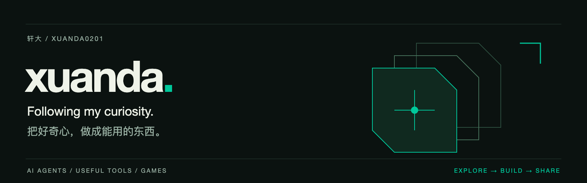

<strong>English</strong> · <a href="https://github.com/xuanda0201/xuanda0201/blob/main/README.zh-CN.md">简体中文</a>

  

  <a href="https://github.com/hutian-ai"><strong>hutian</strong></a> ·
  <a href="https://github.com/hutian-ai/harness-dock">Harness Dock</a> ·
  <a href="https://github.com/civs6-mods">Civilization VI Mods</a>

### Hi, I'm xuanda 👋

I build around **AI agents, human–AI collaboration, and game mods**. I like starting with something I need and turning it into a small project I can run, use, and keep improving.

At [@hutian-ai](https://github.com/hutian-ai), I'm exploring how persistent AI roles can contribute to real projects and build on the knowledge, experience, and work they leave behind.

### What I'm building

<table>
<tr>
<td width="50%" valign="top">

#### Jiezhou · Harness Dock

Let native agent harnesses run tasks for your product.

Connect authorized devices, reuse their native environments, and receive progress, approvals, and artifacts.

`TypeScript` · `SDK` · `Self-hosted`

**Public · Developer Alpha**

[Source →](https://github.com/hutian-ai/harness-dock)　[Docs →](https://hutian-ai.github.io/harness-dock/)

</td>
<td width="50%" valign="top">

#### Civ VI Mods · Civilization VI

Quality-of-life tools, automation, and new ways to play.

Build bridges with BridgeSpan, automate recurring tasks, and spend more time on decisions.

`Lua` · `Civilization VI` · `Modding`

**Projects moving into independent repositories**

The earlier combined repository contains demos and prototypes. Ongoing mods are being organized into separate repositories under [@civs6-mods](https://github.com/civs6-mods), with their own documentation and releases.

[Mod workshop →](https://github.com/civs6-mods)　[Browse projects →](https://github.com/orgs/civs6-mods/repositories)

</td>
</tr>
</table>

I'm also building these open-source modules at [@hutian-ai](https://github.com/hutian-ai):

| Project | What it does |
| :--- | :--- |
| [Hutian Design](https://github.com/hutian-ai/hutian-design) | Reusable React components and chat UI for agent applications. |
| [Matrix Agents Chat](https://github.com/hutian-ai/matrix-agents-chat) | Matrix-based communication for people and agents, with a TypeScript SDK, CLI, local web client, and human-directed handoff. |
| [Memory Access](https://github.com/hutian-ai/memory-access) | Resource-scoped REST, MCP, and CLI access to memory backends, with sources and operation receipts. |

**Actively iterating.** Interfaces, setup, and interactions may change as I use these projects. Check each repository's README and version notes before getting started.

### Exploring what's next

**hutian** is the longer-term direction: a shared world where people work with persistent AI roles. The Web workspace is in MVP development and remains private; the execution, UI, communication, and memory modules above are public and can be used independently.

I like growing projects through real use: solve a concrete problem, ship something useful, then take the next step. If you have a use case or feedback, explore the projects at [hutian](https://github.com/hutian-ai) or [Civ VI Mods](https://github.com/civs6-mods) and follow each project’s feedback links.

---

Explore → Build → Use → Improve

