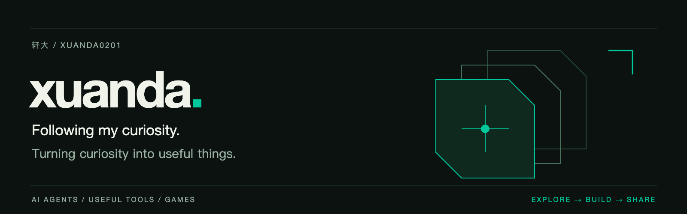

<strong>English</strong> · <a href="https://github.com/xuanda0201/xuanda0201/blob/main/README.zh-CN.md">简体中文</a>

  

  <a href="https://github.com/hutian-ai"><strong>hutian</strong></a> ·
  <a href="https://github.com/hutian-ai/harness-dock">Harness Dock</a> ·
  <a href="https://github.com/xuanda0201/civ6-mods">Civilization VI Mods</a>

### Hi, I'm xuanda 👋

I build around **AI agents, human–AI collaboration, and automation in games**. I like starting with something I need and turning it into a small project I can run, use, and keep improving.

At [@hutian-ai](https://github.com/hutian-ai), I'm exploring how persistent AI roles can contribute to real projects and build on the knowledge, experience, and work they leave behind.

### What I'm building

<table>
<tr>
<td width="50%" valign="top">

#### Jiezhou · Harness Dock

Let native agent harnesses run tasks for your product.

Connect authorized devices, reuse their native environments, and receive progress, approvals, and artifacts.

`TypeScript` · `SDK` · `Self-hosted`

**Public · Developer Alpha**

[Source →](https://github.com/hutian-ai/harness-dock)　[Docs →](https://hutian-ai.github.io/harness-dock/)

</td>
<td width="50%" valign="top">

#### Civilization VI · Mods

Automate the repetition. Keep the decisions.

Small tools for recurring city projects, spy missions, builder work, Great Works organization, and rail construction.

`Lua` · `Civilization VI` · `Automation`

**Public · Preview, awaiting in-game validation**

[Source & downloads →](https://github.com/xuanda0201/civ6-mods)　[Installation →](https://github.com/xuanda0201/civ6-mods/blob/main/INSTALL.md)

</td>
</tr>
</table>

### Exploring what's next

**hutian** is the longer-term direction: a shared world where people work with persistent AI roles. The Web workspace is in local development; Harness Dock is the public starting point you can try today.

I like growing projects through real use: solve a concrete problem, ship something useful, then take the next step. If you have a use case or feedback, join the conversation in [Harness Dock](https://github.com/hutian-ai/harness-dock/issues) or [Civilization VI Mods](https://github.com/xuanda0201/civ6-mods/issues).

---

Explore → Build → Use → Improve

