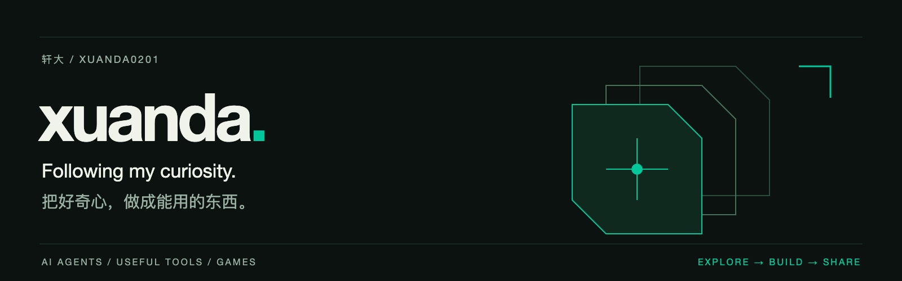

<a href="https://github.com/xuanda0201">English</a> · <strong>简体中文</strong>

  

  <a href="https://github.com/hutian-ai"><strong>hutian</strong></a> ·
  <a href="https://github.com/hutian-ai/harness-dock">Harness Dock</a> ·
  <a href="https://github.com/xuanda0201/civ6-mods">文明 6 Mods</a>

### 你好，我是轩大 👋

关注 **AI Agent、人与 AI 的协作，以及游戏里的自动化**。喜欢从自己的实际需求出发，把一个想法做成能运行、能体验、能继续改进的小作品。

正在 [@hutian-ai](https://github.com/hutian-ai) 构建工具与产品，探索让 AI 角色参与真实项目，并留下可继续使用的资料、经验与成果。

*I follow my curiosity by building useful tools — for AI agents, human-directed collaboration, and games.*

### 最近在做

<table>
<tr>
<td width="50%" valign="top">

#### 界舟 · Harness Dock

让原生 Harness，为你的产品执行任务。

连接获授权的设备，复用已有的原生环境，接回进度、审批与产物。

`TypeScript` · `SDK` · `Self-hosted`

**已公开 · Developer Alpha**

[源码 →](https://github.com/hutian-ai/harness-dock)　[文档 →](https://hutian-ai.github.io/harness-dock/)

</td>
<td width="50%" valign="top">

#### 文明 6 · Mods

把重复操作交给工具，把注意力留给决策。

城市项目续建、间谍循环、建造者作业、巨作整理和沿途铁路等小工具。

`Lua` · `Civilization VI` · `Automation`

**已公开 · 预览版，待实机验证**

[源码与下载 →](https://github.com/xuanda0201/civ6-mods)　[安装说明 →](https://github.com/xuanda0201/civ6-mods/blob/main/INSTALL.md)

</td>
</tr>
</table>

### 继续探索

**hutian** 是正在推进的长期方向：一个让持续角色与人共同工作的世界。Web 工作台还在本地开发中，当前可体验的公开成果从 Harness Dock 开始。

我更愿意让项目在真实使用中逐步长大：先解决一个具体问题，留下能用的成果，再继续下一步。也欢迎带着实际使用场景，在 [Harness Dock](https://github.com/hutian-ai/harness-dock/issues) 或 [文明 6 Mods](https://github.com/xuanda0201/civ6-mods/issues) 中交流。

---

好奇 → 动手 → 用起来 → 再改进

